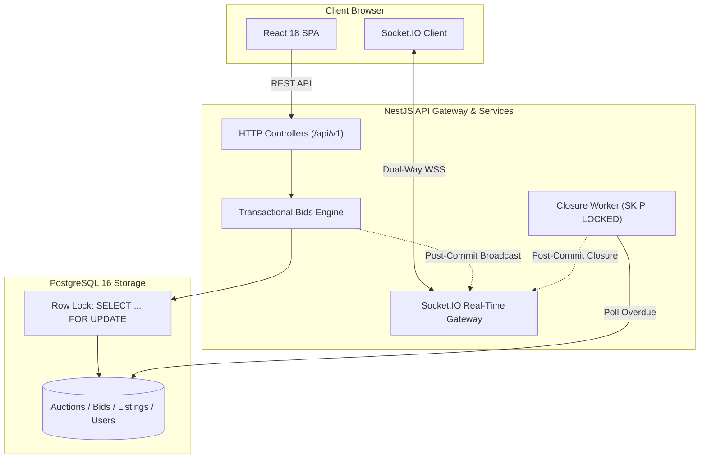
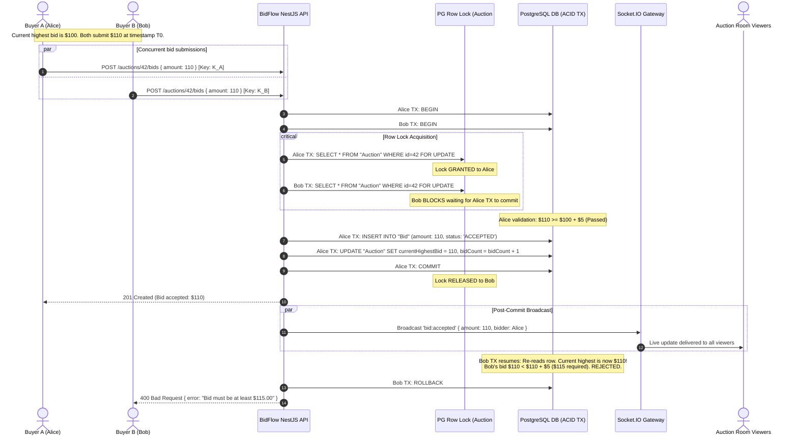

# BidFlow — Real-Time Campus Auction Marketplace

[](https://www.typescriptlang.org/)
[](https://nestjs.com/)
[](https://react.dev/)
[](https://www.postgresql.org/)
[](https://socket.io/)
[](https://www.prisma.io/)

A full-stack, real-time auction marketplace engineered for university campus student commerce (used textbooks, laptops, electronics, calculators, lab gear). Built with a focus on transactional correctness, concurrency-safe bidding, and automated lifecycle closures.

---

## 1. Problem Statement & Engineering Purpose

Traditional student marketplace apps (forums, buy/sell groups) suffer from price haggling, ghosting, and non-transparent bidding. Meanwhile, naive online auction platforms break under simultaneous bidding due to **lost update race conditions**, where multiple bids placed in the same millisecond overwrite each other or accept invalid lower prices.

**BidFlow** solves this by enforcing:
1. **Pessimistic Row-Level Locking (`SELECT ... FOR UPDATE`)**: Guarantees serializable transactions at the PostgreSQL database layer, strictly preventing race conditions and negative margin increments.
2. **Post-Commit WebSocket Broadcast**: Socket.IO events are emitted only after ACID commits succeed, preventing dirty real-time state leaks.
3. **Soft-Close Anti-Sniping**: Automatically extends the auction deadline by 2 minutes if a bid lands in the final 30 seconds.
4. **Idempotent Background Closure**: Uses PostgreSQL `FOR UPDATE SKIP LOCKED` row skipping to finalize overdue auctions reliably across crashes or horizontally scaled instances.
5. **Cryptographic Idempotency**: Prevents double-clicks and network-retry duplicates via unique `Idempotency-Key` tracking.

---

## 2. Technology Stack

### Frontend (`apps/web`)
- **React 18** with **TypeScript** & **Vite**
- **Tailwind CSS** for modern UI styling
- **TanStack Query** for client-side server-state management
- **React Router v6** for client-side routing
- **Socket.IO Client** for real-time bid streams & notifications
- **Lucide React** for icons

### Backend (`apps/api`)
- **Node.js** & **TypeScript**
- **NestJS** (Modular Architecture)
- **Prisma ORM** + Parameterized Raw SQL for row locking
- **Socket.IO** Gateway for auction rooms (`auction:<id>`) and user alerts (`user:<userId>`)
- **Passport JWT** & **Bcrypt** for secure authentication and RBAC
- **PostgreSQL 16** as the authoritative source of truth

---

## 3. High-Level Architecture & Concurrency Strategy



### The Pessimistic Row Locking Solution
```sql
BEGIN;
SELECT a.*, l."minIncrement"
FROM "Auction" a
JOIN "Listing" l ON a."listingId" = l.id
WHERE a.id = $1
FOR UPDATE OF a;

-- 1. Validate status == 'ACTIVE'
-- 2. Validate authoritative server time: now >= startTime && now < endTime
-- 3. Validate bidder != seller
-- 4. Validate amount >= currentHighestBid + minIncrement
-- 5. Calculate anti-sniping extension if endTime - now <= 30s
-- 6. Insert into "Bid"
-- 7. Update "Auction" currentHighestBid, currentHighestBidderId, endTime
COMMIT;
-- Lock released to next waiting transaction in kernel queue
```

---

## 4. End-to-End Concurrent Bidding Sequence



---

## 5. Quickstart & Local Setup Instructions

### 1. Start PostgreSQL (Docker)
```bash
docker compose up -d
```

### 2. Push Schema & Seed Realistic Campus Data
```bash
npx prisma db push --schema=prisma/schema.prisma
npx ts-node prisma/seed.ts
```

### 3. Start Development Servers
```bash
# Terminal 1: Backend API (Port 4000)
npm run dev:api

# Terminal 2: Frontend Web (Port 5173)
npm run dev:web
```

Access the application in your browser: **http://localhost:5173**

---

## 6. Pre-Seeded Campus Test Accounts

Use the **1-Click Demo Login** buttons on the login page or enter:

| Role | Email | Password |
| :--- | :--- | :--- |
| **Buyer** | `rahul.buyer@university.edu` | `Password123!` |
| **Seller** | `alex.seller@university.edu` | `Password123!` |
| **Admin** | `admin@university.edu` | `Password123!` |

---

## 7. Automated Testing Suite

```bash
# Run NestJS Unit Tests
npm run test --workspace=apps/api

# Run Real PostgreSQL Concurrency Race Condition Test
npm run test:concurrency
```

---

## 8. Technical Interview Talking Points

- **Why Pessimistic Locking over Optimistic Locking?** Optimistic locking (`WHERE version = N`) fails severely under hot-item bidding bursts, causing high client retry exhaustion and abandoned carts. Pessimistic locks serialize transactions in microsecond queues in Postgres with zero dropped bids.
- **Why Denormalize `currentHighestBid` on the Auction table?** Bounded transactional write cost provides $O(1)$ read performance across marketplace search/card rendering without table scanning the `bids` table.
- **Why Post-Commit Socket.IO Emissions?** Emitting WebSocket events before a database commit risks broadcasting uncommitted dirty data that could roll back on database error.
