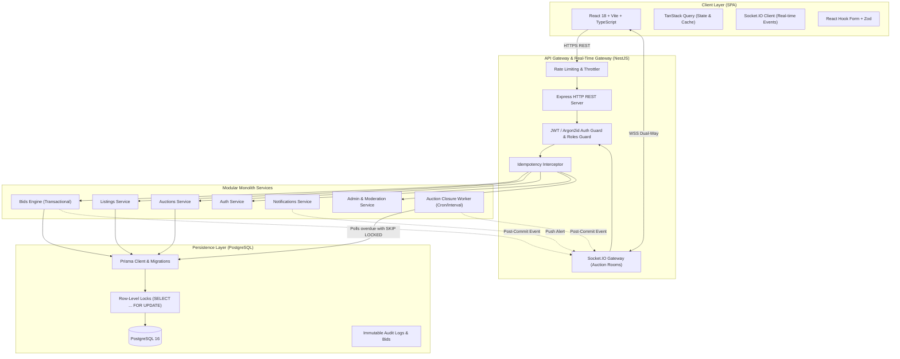
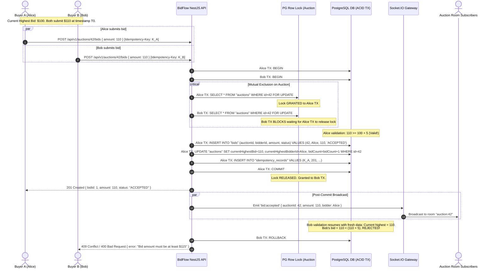
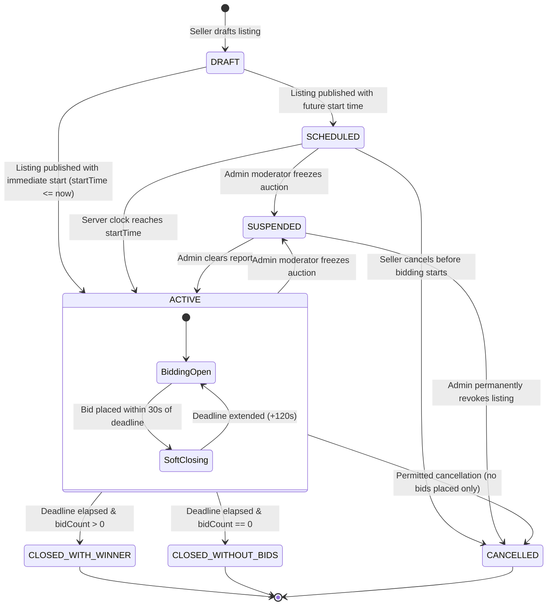
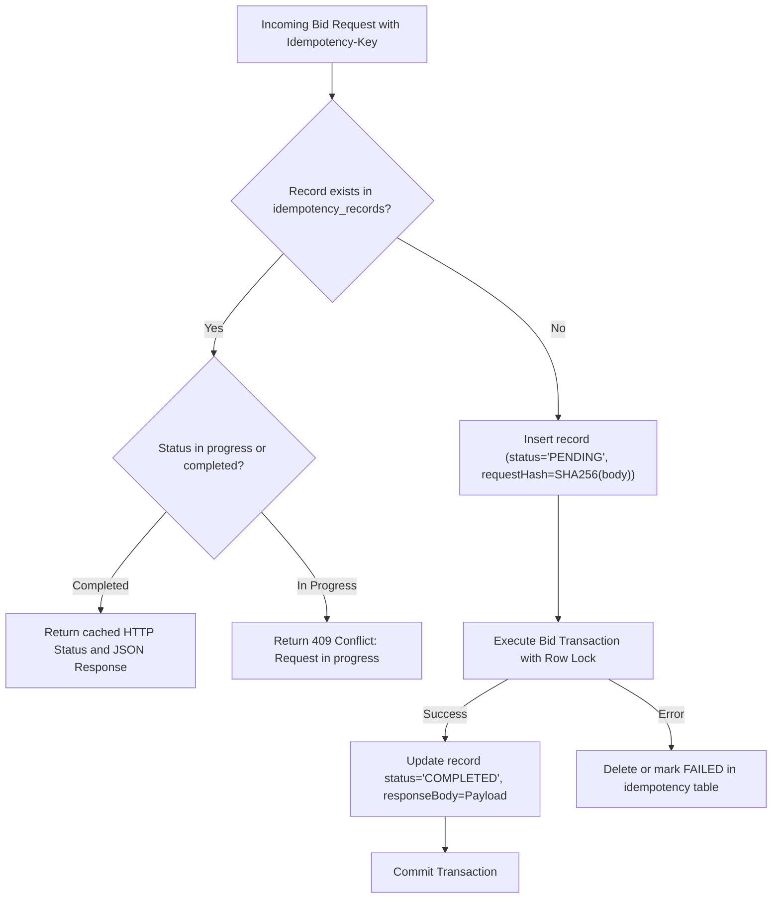

# BidFlow — Architecture & System Design Document

## 1. System Overview & Executive Summary

**BidFlow** is a production-grade, concurrency-resilient real-time auction marketplace. While specifically tailored for a university ecosystem (textbooks, laptops, lab hardware, electronics), the domain model and architectural principles are designed for general-purpose high-concurrency auction environments.

### Core Architectural Differentiators
1. **Pessimistic Row-Level Lock Serializability**: Utilizes PostgreSQL `SELECT ... FOR UPDATE` row locks to serialize concurrent bid submissions per auction. Eliminates lost-update phenomena, phantom bids, and negative margin race conditions.
2. **Post-Commit Real-Time Broadcast**: Socket.IO events are emitted strictly after the transactional database commit succeeds, eliminating dirty real-time state leaks.
3. **Transactional Anti-Sniping (Soft-Close)**: Automatically extends the auction deadline by a configurable interval ($T_{\text{extend}} = 120s$) if an accepted bid occurs within the final window ($T_{\text{threshold}} = 30s$), calculated using the authoritative server clock.
4. **Idempotent At-Least-Once Closure Worker**: Background job utilizing `SKIP LOCKED` row querying to guarantee that overdue auctions are processed exactly once per auction lifecycle, surviving process restarts with zero duplicate winner events.
5. **Request Idempotency Engine**: Cryptographic payload-hashed idempotency keys prevent network-retry duplicates and double-click bid spikes.

---

## 2. High-Level System Architecture



---

## 3. End-to-End Concurrent Bidding Sequence

The sequence below illustrates two users, **Alice** and **Bob**, attempting to bid simultaneously on the same auction item with starting price \$100 and minimum increment \$5.



---

## 4. Auction Lifecycle State Machine



---

## 5. Idempotency & Deduplication Engine

Every mutating financial request (`POST /api/v1/auctions/:id/bids`) accepts an `Idempotency-Key: <UUIDv4>` header.



---

## 6. Background Closure Worker Strategy

To guarantee that auctions close at their deadlines without depending on client countdown timers or volatile in-memory timers:

1. **Interval Worker**: Runs every 10 seconds.
2. **Atomic Batch Selection**:
   ```sql
   SELECT id FROM "auctions"
   WHERE status = 'ACTIVE' AND "endTime" <= NOW()
   ORDER BY "endTime" ASC
   LIMIT 20
   FOR UPDATE SKIP LOCKED;
   ```
3. **Worker Processing**:
   - Queries highest accepted bid for the auction.
   - If highest bid exists: status $\to$ `CLOSED_WITH_WINNER`, `winningBidId` set, creates winning notification for buyer and seller.
   - If no bids exist: status $\to$ `CLOSED_WITHOUT_BIDS`.
   - Commits transaction.
   - Emits `auction:closed` event over Socket.IO to room `auction:<id>`.
4. **Resilience**: `SKIP LOCKED` guarantees that across container restarts or horizontal replicas, workers never process the same auction concurrently.
