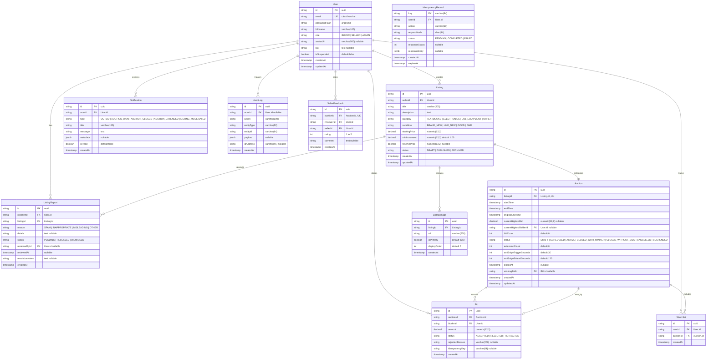

# BidFlow — Database Design Specification

## 1. Database Philosophy & Invariants

1. **Authoritative Source of Truth**: PostgreSQL is the single source of truth for all auction states, bids, balances, and outcomes.
2. **Fixed-Point Decimal Arithmetic**: All monetary quantities (`startingPrice`, `minIncrement`, `amount`, `reservePrice`) use `DECIMAL(12, 2)` to eliminate IEEE-754 floating-point inaccuracies.
3. **Pessimistic Concurrency**: Row-level locking (`SELECT ... FOR UPDATE`) is employed during all state transitions and bid evaluations.
4. **Denormalization Rationale**:
   - `auctions.currentHighestBid` and `auctions.currentHighestBidderId` are denormalized on the auction row to allow $O(1)$ read performance during high-throughput queries (market feed, search filtering, card rendering).
   - Invariant: The denormalized `currentHighestBid` is strictly updated within the **same** ACID transaction that records the accepted `bids` row.
5. **Immutable Audit History**: Accepted bids are append-only. Deleting a user or cancelling an auction never destroys bid history.

---

## 2. Entity-Relationship Diagram (ERD)

---

## 3. Indexes & Performance Optimization Strategy

| Table | Index Columns | Index Type | Purpose |
| :--- | :--- | :--- | :--- |
| `auctions` | `(status, endTime)` | B-Tree | High-speed polling for active/overdue auctions by background worker |
| `auctions` | `(listingId)` | B-Tree (Unique) | 1-to-1 lookup between listing and auction |
| `bids` | `(auctionId, amount DESC)` | B-Tree | Rapid evaluation of highest bid and leaderboards |
| `bids` | `(auctionId, createdAt DESC)` | B-Tree | Paginated chronological bid history |
| `bids` | `(bidderId, createdAt DESC)` | B-Tree | User bid history dashboard |
| `watchlists` | `(userId, auctionId)` | B-Tree (Unique) | Deduplicate user watchlist entries |
| `notifications` | `(userId, isRead, createdAt DESC)` | B-Tree | Filter unread notifications rapidly |
| `idempotency_records`| `(expiresAt)` | B-Tree | Periodic cleanup of stale idempotency keys |
| `listings` | `(category, status)` | B-Tree | Marketplace browsing and category filter |
| `listings` | `to_tsvector('english', title \|\| ' ' \|\| description)` | GIN | Full-text keyword search across marketplace |
